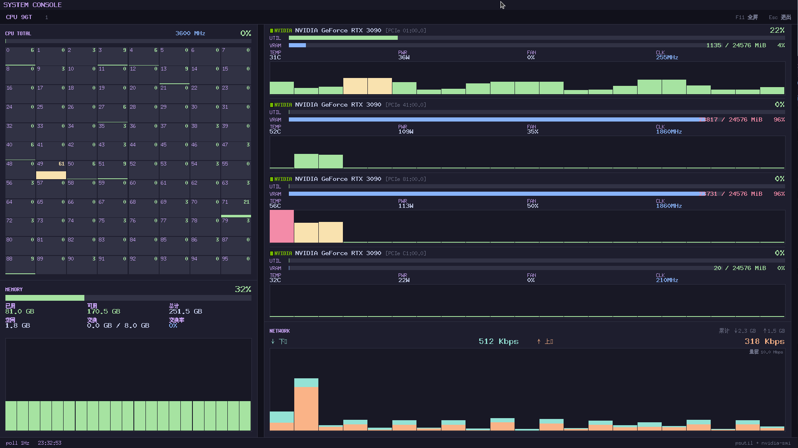

# System Console (Linux)

`system_console.py`(Windows 版)的 Linux 移植:布局、配色(Catppuccin Mocha)、交互完全一致。
见 [screenshot.png](screenshot.png)(Windows 版)与下方"与 Windows 版差异"。



## 要求
- X11 会话(Wayland 下过场:见"差异");Python 3 + tkinter + psutil
- GPU 面板需 NVIDIA 驱动(`nvidia-smi` 在 PATH,直接用系统版本,无需捆绑);无 N 卡时该面板留空,其余正常

```bash
sudo apt install python3-tk python3-psutil   # Debian/Ubuntu
python3 system_console_linux.py
```

## 构建单文件 exe(PyInstaller,在本机平台跑)
```bash
python3 -m PyInstaller "System Console Linux.spec" --noconfirm
# 产物:dist/system-console
```

安装 desktop 入口(可选):
```bash
mkdir -p ~/.local/share/applications ~/.local/share/icons
cp system_console.png ~/.local/share/icons/
# 把 system_console.desktop 里的 Exec= 改成实际路径后:
desktop-file-install --dir=~/.local/share/applications system_console.desktop
```

## 与 Windows 版差异
| 项 | Windows | Linux |
| CPU TOTAL | WMI 性能计数器 `_Total` | psutil(/proc/stat,与 GNOME 系统监视器/top 同款口径) |
| CPU 频率 | 基频 × Performance % | `/sys/devices/system/cpu/cpu*/cpufreq/scaling_cur_freq`(取最大核) |
| CPU 型号 | `wmic cpu get name` | `/proc/cpuinfo` |
| GPU | nvidia-smi(捆绑兜底 exe) | nvidia-smi(系统版本直用,查询参数不变) |
| 全屏显示器定位 | EnumDisplayMonitors(ctypes) | `xrandr --listmonitors`(仅 X11;失败回退主屏) |
| 字体 | Consolas | DejaVu Sans Mono |
| 位置记忆 | `%APPDATA%\System Console\position.json` | `$XDG_CONFIG_HOME/system-console/position.json` |
| 打包 | spec + Inno Setup | spec(无安装器;`.desktop` 入口) |

其余(布局/字号/颜色/历史图/F11/Esc/Q/右键/拖拽/位置保存)逐行对应,未改动。

**Wayland 注意**:`overrideredirect` 无边框与拖拽在多数 Wayland 合成器上不生效或不稳定
(Wayland 不允许客户端自定位);建议 X11 会话,或等 XWayland 下 WM 兼容行为。

## 自检
```bash
python3 system_console_linux.py --test          # 数据层:CPU/内存/GPU/网络
python3 system_console_linux.py --selftest-gui  # GUI:全屏/恢复几何(需图形环境)
```
