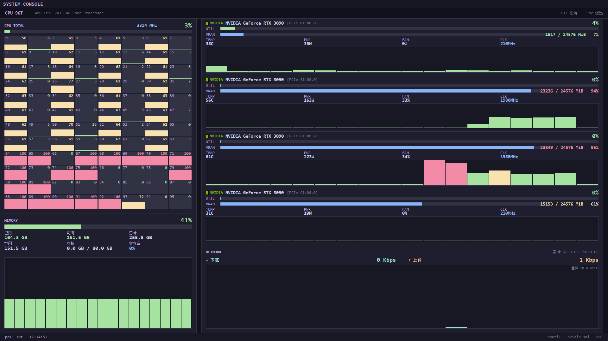

# System Console

桌面整合监控 HUD —— 1920×1080,左列 CPU + 内存,右侧 GPU 多卡,右下网络上传/下载。
无边框窗口可拖拽,F11 在窗口所在显示器全屏。



## 布局

- **左列**:CPU 全核心即时网格(逐核利用率,8 列排布)+ 总览 + 内存面板
  (总览大条 + 已用/可用/总计/空闲/交换 + 60 秒历史图)
- **右侧**:GPU 逐卡卡片(品牌色标 + 型号 + PCIe 槽位,UTIL / VRAM 条,
  TEMP / PWR / FAN / CLK,60 秒历史图)
- **右下**:网络实时上传/下载速率(双色)、60 秒历史图(自动量程)、累计流量

## 特性

- **CPU TOTAL 与任务管理器同款口径**:WMI 性能计数器
  (`Win32_PerfFormattedData_Counters_ProcessorInformation` `_Total`),
  频率为实时值(基频 × Processor Performance %)
- **GPU 数据源**:`nvidia-smi`,CLK 显示实时核心频率(`clocks.current.graphics`);
  优先目标机系统版本,随包捆绑一份兜底,无黑窗闪烁
- **配色**:Catppuccin Mocha
- **无边框窗口**:自绘标题条拖拽移动;位置记忆(`position.json`)
- **F11 全屏**:在窗口当前所在显示器全屏(多显示器友好);Esc 恢复原位置
- **Esc / Q / 右键** 退出

## 下载与安装

**要求**:Windows 10/11 x64;GPU 面板需 NVIDIA 显卡驱动(无 NVIDIA 卡时其余面板正常)。

**构建**:

```bat
:: 1) PyInstaller 单文件 exe
python -m PyInstaller "System Console.spec" --noconfirm
:: 2) Inno Setup 安装包(需 Inno Setup 6)
"C:\Program Files (x86)\Inno Setup 6\ISCC.exe" system_console.iss
```

产物:`installer\System Console Setup.exe`,装到 `C:\Program Files\System Console`,
可选开始菜单/桌面图标,装完自动启动。

> 中文界面语言文件 `langs_ChineseSimplified.isl` 已随仓库提供
> (Inno Setup 6.5 官方未带简体中文),`system_console.iss` 直接引用它。

## 文件说明

| 文件 | 用途 |
|---|---|
| `system_console.py` | 主程序(tkinter 自绘,依赖 psutil + pywin32) |
| `System Console.spec` | PyInstaller 打包配置(捆绑 `tools/nvidia-smi.exe`) |
| `system_console.iss` | Inno Setup 安装脚本 |
| `make_icon.py` | 应用图标生成(PIL) |
| `system_console.ico` | 应用图标 |
| `tools/nvidia-smi.exe` | 随包捆绑的 nvidia-smi(兜底数据源) |

## 备注

- 本机 `win32pdh` 的 `AddEnglishCounter` 不可用(报 Unicode 转换错误),
  任务管理器同款 CPU 数据走 WMI(`win32com`)。
- 姊妹项目:[gpu-console](https://github.com/JumpEggKiller/gpu-console)、
  [cpu-console](https://github.com/JumpEggKiller/cpu-console)。

## License

MIT — see [LICENSE](LICENSE)
