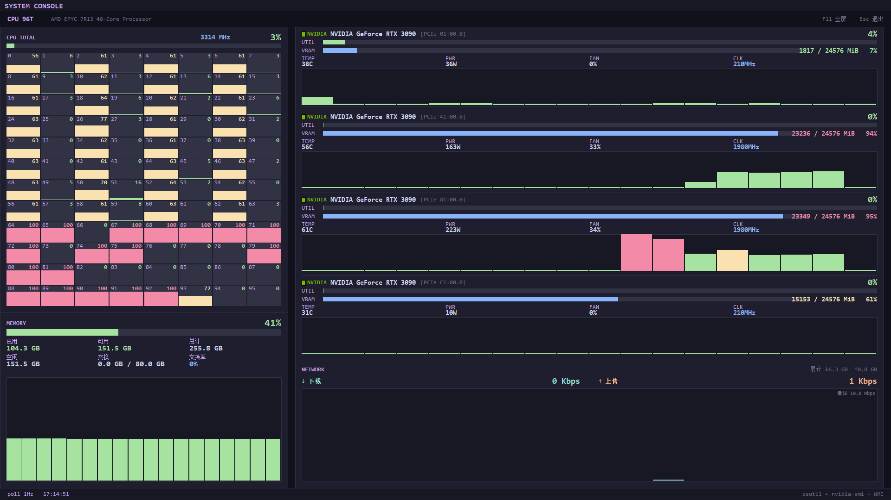

## System Console 1.0.0 (Windows x64)

桌面整合监控 HUD —— 1920×1080,左列 CPU + 内存,右侧 GPU 多卡,右下网络上传/下载。

### 功能
- CPU 全核心即时网格 + 任务管理器同款 TOTAL(WMI)与实时频率
- GPU 逐卡卡片:UTIL / VRAM / TEMP / PWR / FAN / CLK(实时核心频率)+ 60 秒历史图
- 网络实时上传/下载速率 + 60 秒历史图(自动量程)+ 累计流量
- 内存面板:总览大条 + 已用/可用/总计/空闲/交换 + 60 秒历史图
- 配色:Catppuccin Mocha
- 无边框窗口拖拽移动、位置记忆
- F11 在窗口所在显示器全屏(多显示器友好)、Esc / Q / 右键退出

### 要求
- Windows 10 / 11 (x64)
- GPU 面板需 NVIDIA 显卡驱动(随包已捆绑 nvidia-smi 作为兜底)

### 安装
1. 下载下方 **System Console Setup.exe**
2. 右键 → 以管理员身份运行(或点 UAC)
3. 默认装到 `C:\Program Files\System Console`,装完自动启动

### 快捷键
| 键 | 功能 |
|---|---|
| F11 | 在所在显示器全屏 / 退出全屏 |
| Esc / Q / 右键 | 退出 |
| 拖动顶部 | 移动窗口 |

---
构建:PyInstaller(单文件)+ Inno Setup(一键安装包)· MIT 许可证
